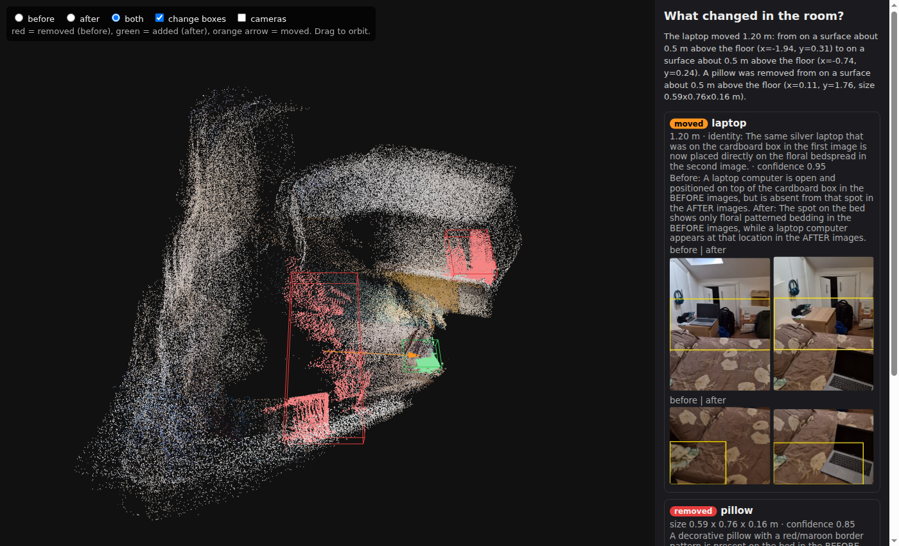
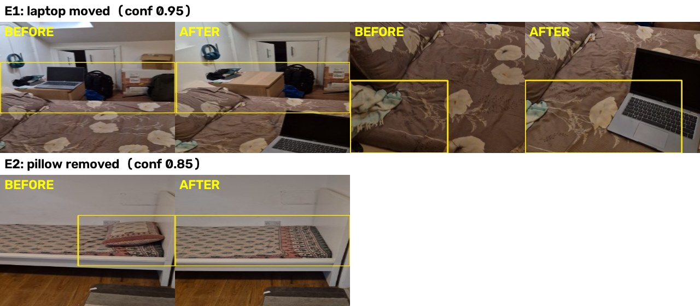
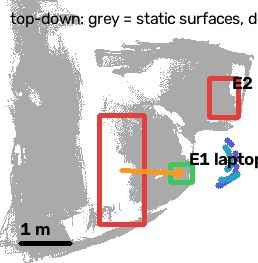
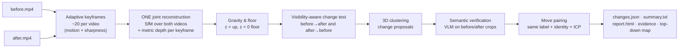
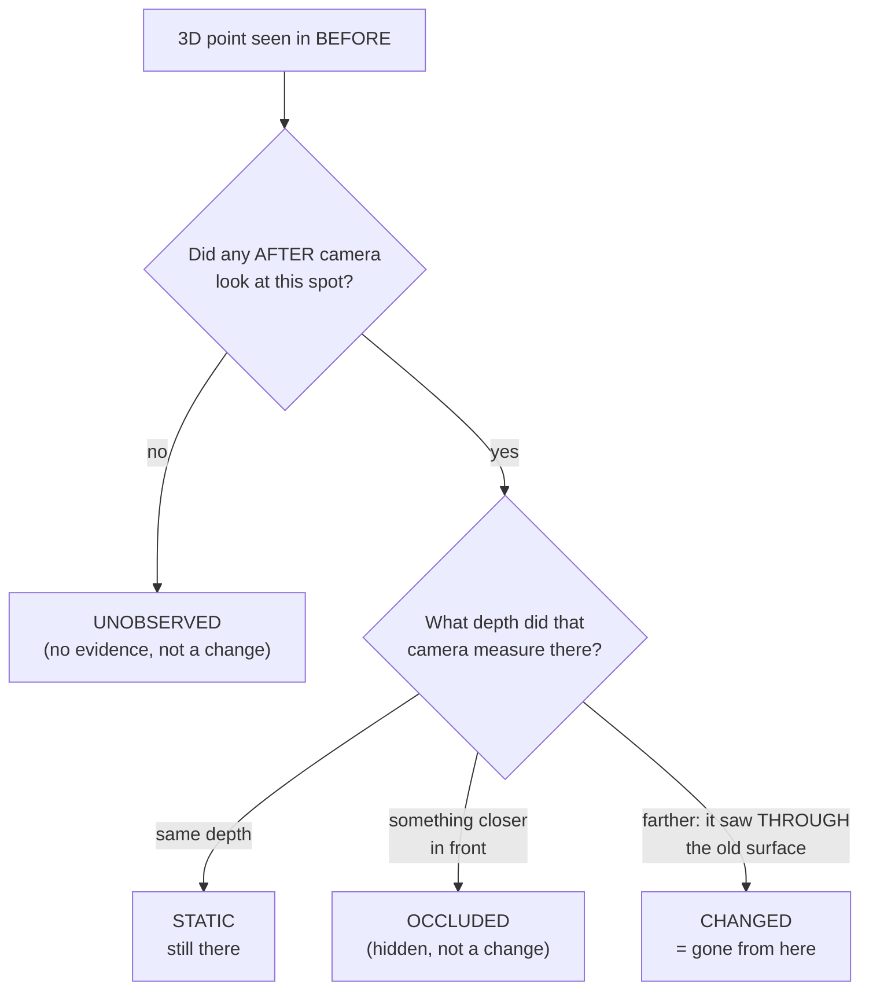
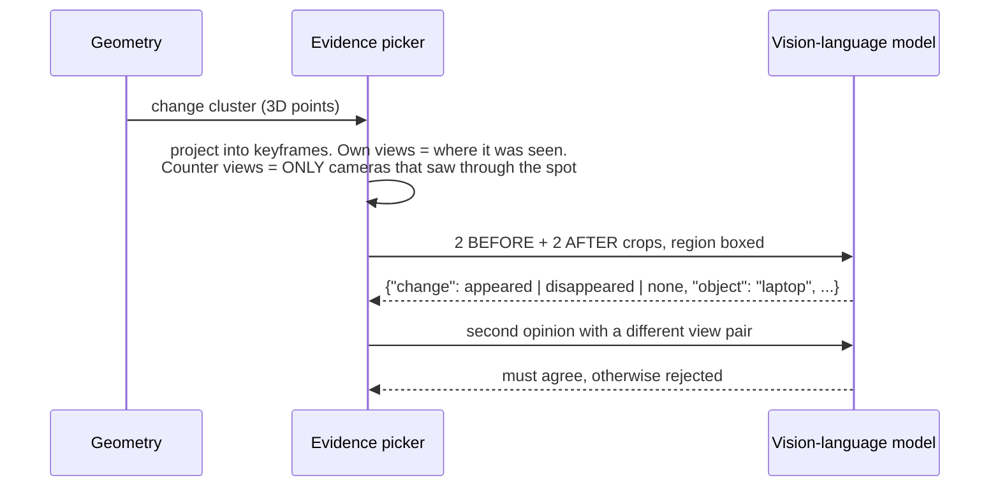
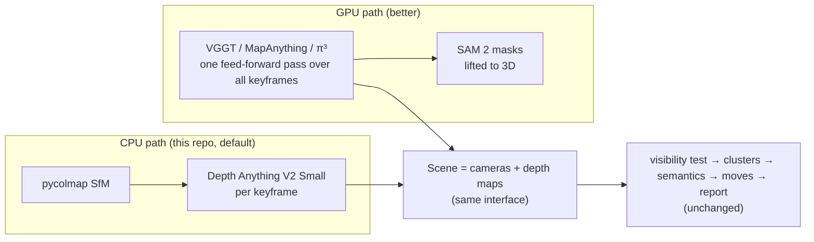

# What Changed in the Room?

**Two phone videos in → a 3D map of what was moved, added or removed, with labels and evidence.**

  

Record a room, change a few things, record it again from a different path. The system builds **one shared 3D
reconstruction** from both recordings, finds regions whose geometry really changed (and not just because the
camera looked from somewhere else, something was in the way, or a corner was never filmed), names each change with
a vision-language model, links "removed here" + "added there" into a single **moved** event, and writes an
interactive 3D report.

```bash
uv sync
uv run python -m whatchanged examples/room01/before.mp4 examples/room01/after.mp4 --out out/room01
xdg-open out/room01/report.html     # macOS: open …
```

---

## Result on the included example

`examples/room01`: two handheld phone clips (5 s and 8 s) of a bedroom. Between them the **laptop was moved**
from the bedside box onto the double bed and the **cushion was removed** from the single bed.

> **Output summary** (`examples/room01/output/summary.txt`, generated from `changes.json`):
> The laptop moved 1.20 m: from on a surface about 0.5 m above the floor (x=-1.94, y=0.31) to on a surface about
> 0.5 m above the floor (x=-0.74, y=0.24). A pillow was removed from on a surface about 0.5 m above the floor
> (x=0.11, y=1.76, size 0.59x0.76x0.16 m).

| Change | Detected | Notes |
|---|---|---|
| Laptop moved (box → bed) | **moved, 1.20 m** | removed + added clusters paired, identity confirmed by the VLM, shift checked with ICP |
| Cushion removed | **removed** | 0.59 × 0.76 × 0.16 m box on the single bed |
| Everything else | 10 proposals **rejected** | wall, floor, ceiling fan, bed frame, a backpack visible in both videos… (listed in the report) |

**Interactive 3D report**: [`examples/room01/output/report.html`](examples/room01/output/report.html) (a single
self-contained file: download it and open it in a browser). Red = removed, green = added, orange arrow = moved;
click an event card to see its before/after evidence.



| Evidence for each event (3D region projected into the original frames) | Top-down change map (robot view) |
|---|---|
|  |  |

All outputs: [`examples/room01/output/`](examples/room01/output) (`changes.json`, `summary.txt`, `report.html`,
`evidence_sheet.jpg`, `topdown.jpg`, `evidence/*.jpg`).

---

## How it works



**1. Adaptive keyframes instead of frame-by-frame analysis** (`whatchanged/keyframes.py`).
ffmpeg decodes ~5 fps at 640 px (handles phone HEVC and rotation metadata). Cheap sparse optical flow measures how
far the camera moved; frames are picked evenly along that motion curve and snapped to the sharpest neighbour. Of
~800 source frames only ~40 ever reach a neural network.

**2. One shared 3D frame for both videos** (`recon.py`). Keyframes of *both* recordings go into a single
structure-from-motion run (pycolmap), so every camera lands in the same coordinate frame. There is no separate
"align scan A to scan B" step that the moved furniture could confuse. Depth Anything V2 (metric, indoor) gives a dense
depth map per keyframe, scaled to the SfM points (≈ metres) and harmonised across views on the static room.

**3. Gravity** (`align.py`). The largest horizontal plane gives "up"; the lowest dense horizontal layer is the floor.

**4. The key idea: the change test asks whether the space is *visibly* empty now** (`change.py`).



The same test from after→before gives *new* geometry. Additional guards: points the *same* video disagrees about
(depth noise) are dropped, and blank textureless pixels (white walls) can't start a change claim.

**5. Clustering** (`clusters.py`). DBSCAN on changed points; a proposal must be seen in ≥ 3 keyframes, stick out
≥ 4 cm, and sit below 1.6 m (ceilings and skylights are not obstacles and their monocular depth is unreliable).

**6. Semantics only where geometry found something** (`semantics.py`, `objects.py`).



Geometry says *where* something differs; the images say *what* and *which way round*. Counter-evidence views are
restricted to cameras that actually looked through the spot, so the model never compares an object with whatever stood
in front of it. Duplicate clusters of one object (screen + keyboard) are merged.

**7. Moved = removed + added + same object** (`match.py`). Pairs need matching labels, an identity check by the
VLM (offline: CLIP similarity) and an ICP shape check. Displacement is reported in metres.

**8. Report** (`report/`). Everything is written to `changes.json` first; the summary sentence, the 3D viewer and the
evidence sheet are generated from it, so text, geometry and images always agree.

---

## System setup

| Requirement | Version / notes |
|---|---|
| OS | Linux or macOS (tested on Ubuntu 22.04) |
| CPU / RAM | any modern x86-64 / Apple Silicon; **≥ 4 GB RAM free** (the example peaks at 2.0 GB) |
| GPU | **not required** |
| Python | 3.12 (managed by `uv`) |
| ffmpeg + ffprobe | on `PATH` (`sudo apt install ffmpeg` / `brew install ffmpeg`) |
| [uv](https://docs.astral.sh/uv/) | `curl -LsSf https://astral.sh/uv/install.sh \| sh` |
| Disk | ~3 GB for the Python env (CPU PyTorch) + ~0.4 GB of model weights |
| Network | first run downloads Depth Anything V2 Metric-Indoor-Small and CLIP ViT-B/32 from Hugging Face; the VLM step calls your API |

```bash
git clone https://github.com/hackdavid/scene-change-3d.git
cd scene-change-3d
uv sync                 # creates .venv with CPU-only PyTorch, pycolmap, Open3D, transformers…
```

## Keys

Only one thing is needed for the best results: an **OpenAI-compatible vision-language model** (GPT-4o, Claude via
a compatible gateway, a local vLLM server…). It is called a few times per candidate change (~25 calls for the example).

```bash
cp .env.example .env    # then fill in the values
set -a && source .env && set +a
```

| Variable | Meaning |
|---|---|
| `WC_LLM_BASE_URL` | endpoint, e.g. `https://api.openai.com/v1` |
| `WC_LLM_API_KEY` | API key |
| `WC_LLM_MODEL` | a model that accepts images, e.g. `gpt-4o` |
| `OPENAI_BASE_URL` / `OPENAI_API_KEY` / `OPENAI_MODEL` | accepted as a fallback |
| `HF_TOKEN` | optional, only if Hugging Face downloads are rate-limited |

**No key?** `--semantics auto` (the default) falls back to a fully offline CLIP mode: labels come from CLIP and
"is this a real change" from before/after appearance similarity. It works, but it rejects false positives much less
reliably than a VLM.

## Run it on your own videos

```bash
uv run python -m whatchanged path/to/before.mp4 path/to/after.mp4 --out out/myroom
```

| Option | Default | Meaning |
|---|---|---|
| `--out DIR` | `out/run` | output folder (`report.html`, `changes.json`, …) |
| `--keyframes N` | 20 | keyframes per video; more = better coverage, ~1 s extra each on CPU |
| `--semantics auto\|vlm\|clip` | auto | VLM if a key is configured, otherwise CLIP |
| `--no-cache` | off | keyframes and the reconstruction are cached in `DIR/work/`; re-runs with other thresholds take ~40 s |

Any phone video works directly (MP4/MOV, H.264/HEVC, portrait or landscape, any resolution; frames are decoded at
640 px). To keep files small you can downscale first, e.g.
`ffmpeg -i IMG_0001.MOV -vf scale=-2:1920 -c:v libx264 -crf 23 -an before.mp4`.

**Capture guide (this matters more than any setting):**

1. 5–15 s per video, walk slowly **sideways** around the area. Pure rotation on the spot gives no 3D.
2. Film the same area in both videos, with a lot of overlap, but the path doesn't have to be the same.
3. Make clear changes: move or add or remove objects about the size of a shoebox or larger, by ≥ 30 cm.
4. Keep lighting the same, avoid fast pans and motion blur; don't film yourself in mirrors.
5. Make sure every changed spot is seen in *both* videos. A spot filmed only once is reported as unobserved, not as a change.

## Outputs

| File | Content |
|---|---|
| `report.html` | self-contained Three.js viewer: before/after/both point clouds, change boxes, move arrows, cameras, event cards with evidence, rejected proposals |
| `changes.json` | events (`moved` / `removed` / `added`) with 3D boxes in metres (z up from the floor), displacement, label, confidence, description, evidence frames, identity/ICP checks; rejected proposals with reasons; timings and memory |
| `summary.txt` | natural-language summary generated from `changes.json` |
| `evidence_sheet.jpg`, `evidence/` | before/after crops per event, with the 3D region projected into the frames |
| `topdown.jpg` | top-down occupancy view: static room, cameras, change boxes and move arrows |

<details><summary><code>changes.json</code> excerpt</summary>

```json
{
  "type": "moved",
  "label": "laptop",
  "displacement_m": 1.2,
  "confidence": 0.95,
  "from": {
    "center": [
      -1.94,
      0.31,
      0.45
    ],
    "size": [
      0.9,
      2.18,
      0.27
    ]
  },
  "to": {
    "center": [
      -0.74,
      0.24,
      0.47
    ],
    "size": [
      0.44,
      0.36,
      0.16
    ]
  },
  "match": {
    "appearance_similarity": 0.776,
    "identity_check": "The same silver laptop that was on the cardboard box in the first image is now placed directly on the floral bedspread in the second image.",
    "size_ratio": 4.91,
    "icp_fitness": 0.047,
    "icp_rmse_m": 0.025
  }
}
```
</details>

---

## Resource constraints: why CPU, and what we would do with a GPU

This was built and tested on a machine **without a GPU** (8-core Xeon, 31 GB RAM). The default pipeline was chosen to be
accurate enough while running in about 1.5 minutes on a CPU, so that anyone can reproduce it on a laptop.

| Stage (example, fresh run, no cache) | CPU time |
|---|---|
| Keyframe selection (decode + optical flow, both videos) | 2 s |
| SfM: SIFT features + matching + mapping (39 views) | 12 s |
| Depth model load + metric depth for 39 frames | 17 s |
| Visibility-aware change detection + clustering | 5 s |
| Semantic verification (VLM API calls, network-bound) | 52 s |
| **Total** | **92 s**, peak RAM **2.0 GB** |

**What the CPU constraint costs**

- Monocular depth from a small model (392 px input to save time) is noisy on blank walls and object edges, so the
  smallest reliable change is about shoebox size (~15–20 cm). Thin or flat objects (paper, cables) are filtered out on purpose.
- SfM needs sideways camera motion; a pure rotation sweep can fail.
- ~20 keyframes per video; more would improve coverage but cost time.
- No dense segmentation model: an object's extent is the set of changed 3D points, so a box can be larger or smaller than the object.

**With a GPU we would swap in stronger models. Only the reconstruction stage changes:**



| Stage | CPU (this repo) | With a GPU |
|---|---|---|
| Reconstruction | pycolmap SfM + Depth Anything V2 Small | **VGGT / MapAnything / π³**: poses and dense, multi-view-consistent point maps for all keyframes of both videos in one pass (seconds). Much better depth on walls and thin objects, no SfM failure modes |
| Keyframes | ~20 per video | 50–100 per video for full coverage |
| Object extent | changed-point clusters | **SAM 2** masks propagated through keyframes and lifted to 3D for exact object shapes and tight boxes |
| Semantics | API VLM (or offline CLIP) on a few crops | local open VLM + DINOv2 embeddings; no network needed |
| Change tolerance | 6 cm | 2–3 cm, thanks to cleaner geometry |

Everything downstream consumes the same `Scene` object (cameras + depth maps), so a GPU backend plugs in behind
`recon.reconstruct()` without touching the change logic. The VGGT-1B checkpoint was tried on this CPU: it loads,
but a joint pass over ~40 frames was too slow and memory-hungry to be the default (not formally benchmarked).

## Limitations and honest notes

- Validated on one real room (this example) plus a synthetic Blender room used during development
  (`tools/make_synthetic_room.py`). Thresholds are tuned for phone clips of a small room.
- Run-to-run variance is real. The same clips at full 4K (not in git) found the laptop move (1.26 m) but in one run
  missed the cushion and reported two small false changes on the floor behind the bed, where the bed hides the spot
  in most after-views. A detection is only as good as the views that saw the spot.
- The "laptop removed" box is larger than the laptop: it includes the surface the laptop had been hiding.
- Labels and the real-change decision depend on the VLM. The offline CLIP mode is noticeably weaker.

## Repository layout

```
whatchanged/
  keyframes.py   adaptive keyframe selection (ffmpeg + optical flow)
  recon.py       joint SfM + metric depth  → Scene (cameras, depth maps)
  align.py       gravity / floor alignment
  change.py      visibility-aware ray-consistency change test
  clusters.py    3D clustering of changed points
  objects.py     evidence views, crops, duplicate merging
  semantics.py   VLM / CLIP verification, labels, identity check
  match.py       removed + added → moved (label, identity, ICP)
  pipeline.py    orchestration, changes.json, caching
  report/        summary text, evidence sheet, top-down map, Three.js report.html
examples/room01/ before.mp4, after.mp4, output/
docs/PLAN.md     design notes and tradeoffs
bench/           reconstruction benchmark script
tools/           synthetic Blender test-room generator
```
